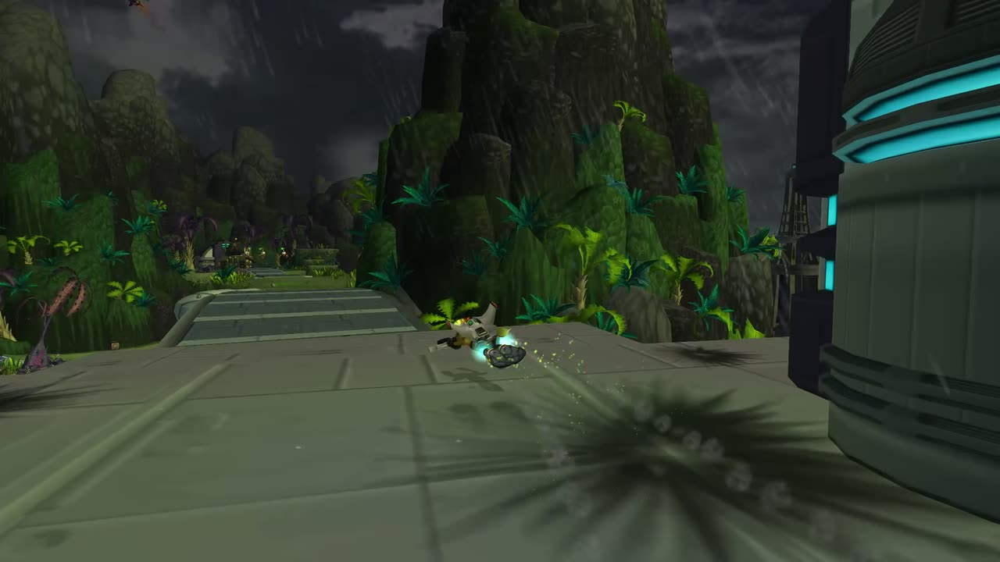
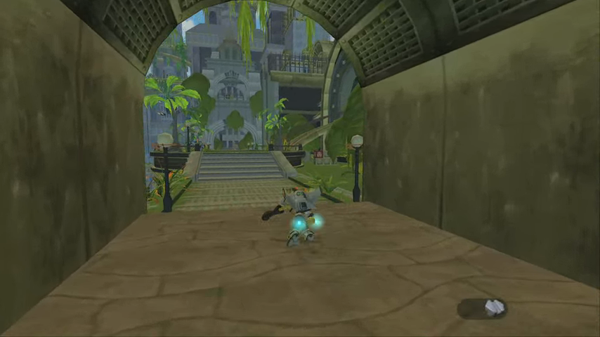

# Thruster Charge

Going Commando's Charge Boots charge, on Clank's Thruster-Pack in Ratchet & Clank.

[Watch it on YouTube](https://youtu.be/f8HDEewX6Qk) (26 s, with sound): charges on Clank's
Thruster-Pack down rain-soaked streets, its flames blue.

## What it does

Ratchet & Clank has no Charge Boots, so this mod gives their charge to the Thruster-Pack, running
Going Commando's own charge code. With the Thruster-Pack on his back, Ratchet charges the way he
faces: fast for the first second, then at a steady pace. Enemies and crates in his way take a
wrench hit, and if he runs into a wall he bonks back off it. The Thruster-Pack's flames turn blue
while he charges.

The charge takes the place of the Thruster-Pack's hover. Its long jump and its boost in a double
jump stay. With the Heli-Pack or no pack, R1 does what it always did.

## How to use it

- Wear the Thruster-Pack.
- On the ground, **double-tap R1 and hold it**: Ratchet charges.
- **Steer with the stick.**
- **Let go of R1** to stop (after a second at least).
- There is no jump out of a charge. After one, half a second passes before the next double tap
  charges again, as in Going Commando.

## Settings

| Setting | Default | Choices | What it does |
|---|---|---|---|
| Speed | 1.0 | 0.5 to 1.5 | Scales the charge's speed; 1.0 is Going Commando's. |
| Pose: from frame | 3 | 0 to 60 | The first frame of the Thruster-Pack long jump's animation that the charge's pose moves between. |
| Pose: to frame | 5 | 0 to 60 | The last frame. The same frame as "from" holds the pose still. |
| Pose: motion | Back and forth | Back and forth, Loop, Hold still | *Back and forth* moves smoothly between the two frames. *Loop* is the game's own loop, which jumps back to the first frame and shakes. *Hold still* holds the first frame. |
| Pose: speed | 0.75 | 0.2 to 2.0 | How fast the pose moves, times the animation's own rate. |
| Rumble while charging | On | On, Off | A short burst of rumble as a charge starts and a very low one while it lasts. Needs the Rumble mod (see below). |

The pose defaults (back and forth between frames 3 and 5, at 0.75) were picked as the best look;
frames 6 and later are the long jump's landing.

## Requirements

- **OpenRAC with mod interface 1.23 or later**: OpenRAC's dev builds from 1.1.1-dev.1063, and the
  next release. A game without it refuses the mod and says why.
- **Ratchet & Clank**, PAL and NTSC-U.
- **Works with [Rumble](https://github.com/Promises/rac1-rumble)** (optional): with the Rumble mod
  loaded and an OpenRAC with mod interface 1.37, a charge rumbles, scaled by Rumble's **Strength**
  setting. Going Commando's Charge Boots never rumbled; this is the mod's own. Without Rumble, or
  on an older OpenRAC, the charge simply never rumbles, and the mod still loads on 1.23.

## Compatibility and known issues

- No conflicts with other mods are declared.
- Not there yet: Going Commando's flames at Ratchet's feet, and its own charge and stop sounds
  (Ratchet & Clank has neither). The charge uses the hover's hum.

## Credits

By Henning Berge. The charge is Going Commando's code, from OpenRAC's
[rac2-decomp](https://github.com/OpenRAC/rac2-decomp).

Licence: GPL-3.0 (details in the [README](README.md#license) and
[THIRD_PARTY_NOTICES.md](THIRD_PARTY_NOTICES.md)).

## Feedback

Found a bug or have an idea? Open an issue on
[GitHub](https://github.com/Promises/rac1-thruster-charge/issues). Pull requests are welcome.

Developer documentation: [README](README.md)
