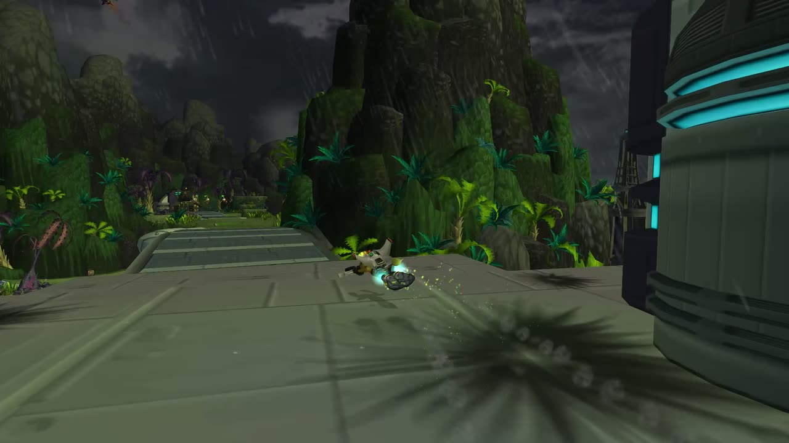

# Thruster Charge

[](https://youtu.be/f8HDEewX6Qk)

*▶ [Watch it on YouTube](https://youtu.be/f8HDEewX6Qk) (26 s, with sound).*

A native mod for [OpenRAC](https://github.com/OpenRAC/OpenRAC)'s port of Ratchet & Clank: Going
Commando's **Charge Boots** charge on Clank's **Thruster-Pack**, running **Going Commando's own
charge code**. With the Thruster-Pack on, double-tap R1 on the ground and hold it: Ratchet charges
the way he faces, at 30 units a second for the first second and 11.5 after, the stick across
turning him. Enemies and crates in his way take a wrench hit. Let go of R1 (after a second at
least) and he stops; run into a wall and he bonks back off it. There is no jump out of a charge.
After a charge, Going Commando's lockout (half a second) passes before the next double tap.

Ratchet & Clank has no Charge Boots (no model, no animation), so the charge runs in what it does
have: the Thruster-Pack. It runs in the hover's state (the same double tap of R1, the same float a
little over the ground) with the hover's hum, in the pose of the Thruster-Pack's long jump (R1 or
R2 and X) without its take-off, landing and sounds: its 14-frame animation starts at frame 3 and
goes back and forth between frames 3 and 5 (3, 4, 5, 4, 3...) for as long as he charges, at 0.75
of the animation's own rate, with no jump back. The game cannot play an animation backwards, so the mod
holds the game's advance and sets the frame itself each tick, between two frames as the game
draws them. The Thruster-Pack's flames turn blue while he
charges. The charge is his whenever the Thruster-Pack is on his back: its double tap charges
instead of hovering. With the Heli-Pack or no pack, R1 does what the game does. The
Thruster-Pack's long jump and its boost in a double jump stay.

Settings: **Speed** scales the charge; **Pose: from frame** and **Pose: to frame** (3 and 5) set
the range, the same frame twice holds it still; **Pose: motion** is back and forth (the default),
the game's loop (it jumps back to the first frame, which shakes), or held still; **Pose: speed**
(0.75) is how fast it goes back and forth, times the animation's own rate.

Tuning notes, from the box (PAL): frames 6 and later are the long jump's landing; the game's loop
shakes at every jump back to its first frame, whatever the range; a single held frame looks
stiff. Back and forth between 3 and 5 at 0.75 is the pick. The game's log says how many frames the long
jump's animation has, once a level.

**Needs OpenRAC with mod interface 1.23 or later**, for four hook points it uses
(`rac1.player.update_movement`, `rac1.fx.world_quad.draw`, `rac1.fx.thruster_flame.draw` and
`rac1.fx.burst.spawn`): OpenRAC's dev builds from 1.1.1-dev.1063, and the next release. A game
without them refuses the mod and says why. The mod is built against the SDK's source at the
OpenRAC `develop` commit `sdk.lock` pins, which has them.

## How it works

The charge is Going Commando's Charge Boots code, copied from its decompilation ([rac2-decomp](https://github.com/OpenRAC/rac2-decomp),
GPL-3.0) into `src/gc/`, unchanged but for marked lines that cut each function down to the
charge:

- `ProcessHeroEquippedItemInput`: the double tap that starts it;
- `hero_l00_set_action`: what entering the charge and the bonk set up;
- `hero_l00_update_state_machine`: the charge's movement (speeds, turn, ground spring, hits,
  lean) and the bonk's;
- `hero_l00_decide_state`: R1 let go stops it, a wall bonks it.

A translation layer (`src/gc/rac1_shim.hpp`, `src/gc/rac1_shim.cpp`, `src/gc/shim/common.h`) runs
that code on Ratchet & Clank's hero:

- **The hero**: the copied code works on Going Commando's hero, a copy the layer fills from
  Ratchet's field by field (velocity, speeds, facing, timers, the stick, the ground...) and writes
  back after, only what the code changed. Going Commando counts 60 frames a second; the layer
  scales speeds, rates and frame counts to the game's tick (a 50th on PAL).
- **States**: Going Commando's charge (state 0x7B) runs in Ratchet & Clank's Thruster-Pack hover
  (0x81), its bonk (0x77) in the game's wall bonk (0x7A), its stop in the stop (3).
- **The boots**: Going Commando asks whether the Charge Boots are owned and worn; here that reads
  "the Thruster-Pack is on his back and not switched off", the hover's own gate.
- **Functions**: Going Commando's are polyfills: Ratchet & Clank's own `speed_step`,
  `set_planar_vel`, `turn_to` and change of state, through their hook points' entries; the SDK's
  collision lines and `moby_hit` for the hits; the hover's hum for the charge's sound; Ratchet's
  body-tilt records for the lean; Ratchet & Clank's own `set_hero_animation` and
  `hero_queue_sequence`, found by name, for the long jump's pose (animation 0x26), its flight
  played back and forth. Each polyfill's comment says what differs from Going Commando.

The mod's own parts: the hooks (`rac1.player.update` around the hero's update,
`rac1.player.update_movement` to move him by the copied code while he charges,
`rac1.player.enter_move_state` to keep the hover the charge's: the Thruster-Pack's own double
tap is refused), and the speed setting.

The blue flames: the game draws each Thruster-Pack flame (`draw_joint_aligned_beam_effect`) as
two textured quads, a red glow and a ribbon, and its update throws orange sparks. While he
charges, the mod turns a tint on around the flame's update (`rac1.moby.moby167.update`) and its
draw (`rac1.fx.thruster_flame.draw`): every effect quad drawn meanwhile (`rac1.fx.world_quad.draw`)
is drawn blue and its record put back, every spark spawned (`rac1.fx.burst.spawn`) is blue, and
the ribbon's colour table is tinted for the charge's length. Every other effect keeps its
colours, and so do the flames outside a charge. One blue for all of them: each colour's
brightest channel kept as its brightness, the hue red 0x18 : green 0x50 : blue 0x80 with the
blue doubled (the PS2's 0x80 is full), so the fire's warm textures still come out bright; each
part's alpha is kept. The grey smoke stays grey.

Not there yet: Going Commando's flames at his feet, and its own charge and stop sounds (Ratchet &
Clank has neither).

## Build

```sh
python3 tools/fetch_sdk.py          # the SDK sdk.lock pins, into .sdk/
cmake -S . -B build -G Ninja
cmake --build build && ctest --test-dir build
python3 .sdk/openrac-mod-sdk-*/tools/package_mod.py build/package/thruster_charge
```

## License

GNU General Public License version 3 ([LICENSE](LICENSE)). The files copied from rac2-decomp are
GPL-3.0-only, as that project gives no later version; the mod's own files are GPL-3.0-or-later.
[THIRD_PARTY_NOTICES.md](THIRD_PARTY_NOTICES.md) names the source, its commit, the files and lines
copied, and its earlier MIT notice; the package carries it as `LICENSE.THIRD_PARTY_NOTICES.md`.
